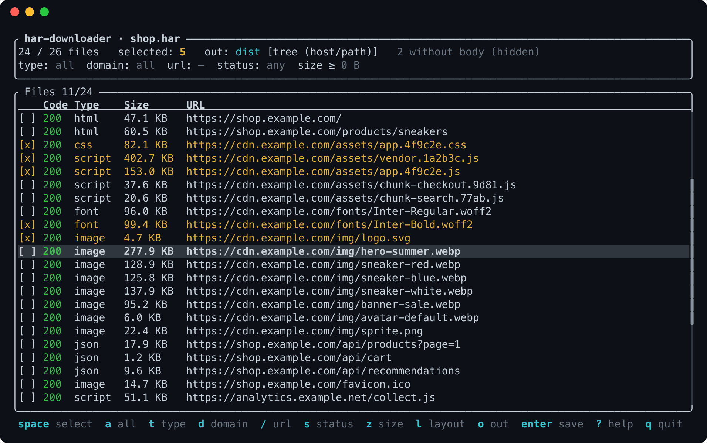
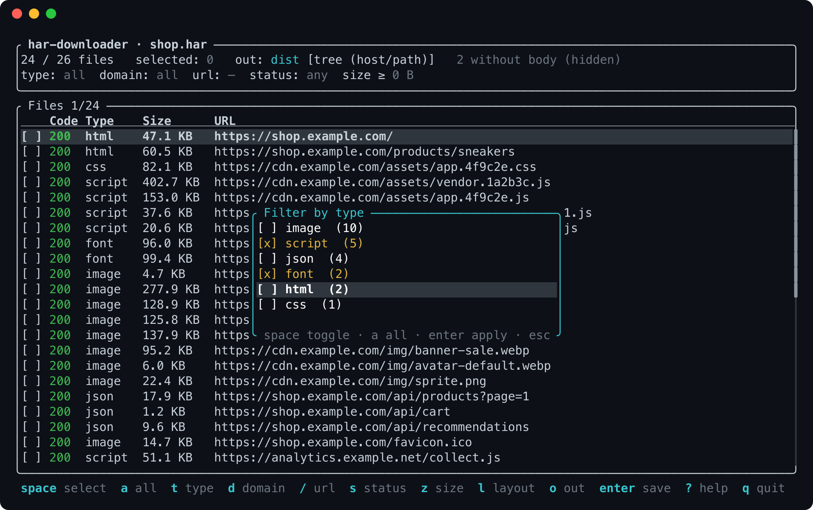
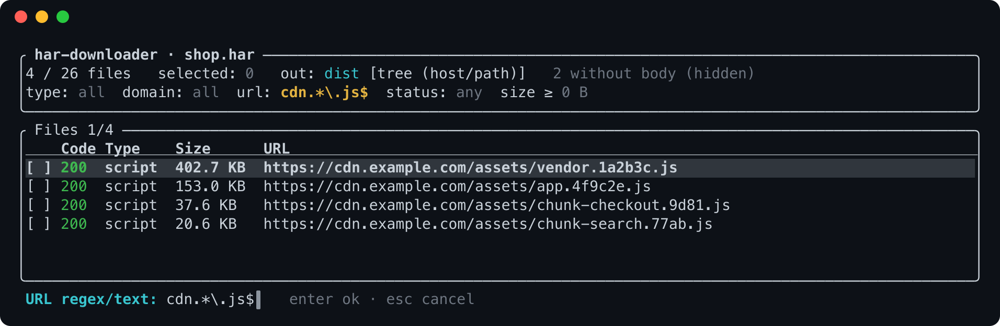

# har-downloader

Browse a `.har` file in a terminal UI, filter the responses, and save them to a folder.

Handy for pulling every image, font, or JS bundle a page loaded, without clicking through DevTools one request at a time.



## Features

- **Interactive TUI** with a scrollable file table (keyboard or mouse wheel)
- **Filters** by type, domain, URL (regex or plain text), status code, and minimum size, all combinable and updated live
- **Pick files one by one**, or save everything that matches the filters
- **Three output layouts**: mirror `host/path`, flat folder, or grouped by type
- **Scriptable**: the same filters work as CLI flags, with `--list` to preview and `--yes` to save without the TUI
- Decodes base64 bodies, adds a missing extension from the MIME type, skips duplicate URLs, and avoids file name collisions

## Install

Requires [Rust](https://rustup.rs) (edition 2024, so Rust 1.85 or newer).

```sh
cargo install --git https://github.com/69Nesta/har-downloader
```

Or from a local clone:

```sh
git clone https://github.com/69Nesta/har-downloader
cd har-downloader
cargo install --path .
```

## Getting a HAR file

In Chrome or Edge: **DevTools → Network** → reload the page → right click any request → **Save all as HAR with content**.
Firefox: **Network** tab → gear icon → **Save All As HAR**.

> [!IMPORTANT]
> The HAR must include response **content**. Without it there are no bodies to save. Entries without a body are hidden by default (press `b` to show them).

## Usage

```sh
har-downloader page.har            # open the TUI, save to ./dist
har-downloader page.har -o assets  # choose the output folder
```

Move with the arrow keys, `space` to select files, `enter` to save. If nothing is selected, `enter` saves every file that matches the current filters.

### Filtering

Press `t` (type) or `d` (domain) to open a checkbox picker:



Press `/` to filter by URL. It's a case-insensitive regex, or plain text if the pattern isn't valid regex:



### Keys

| Key | Action |
|---|---|
| `↑ ↓` / `j k` / mouse wheel | move |
| `PgUp` `PgDn`, `g` / `G` | page up/down, top/bottom |
| `space` | select / unselect file |
| `a` | select all visible (press again to unselect) |
| `c` | clear selection |
| `t` / `d` | filter by type / domain |
| `/` | filter by URL (regex or text, live) |
| `s` | filter by status (`200`, `2xx`, `2xx,304`) |
| `z` | minimum size (`500`, `10k`, `1.5m`) |
| `b` | show / hide entries without a body |
| `r` | reset filters |
| `l` | cycle output layout |
| `o` | change output folder |
| `enter` / `w` | save selected files, or all visible if none selected |
| `?` | help |
| `q` / `esc` | quit |

## Command-line mode

Flags pre-fill the TUI filters. Add `--list` (`-l`) or `--yes` (`-y`) to skip the TUI entirely:

```console
$ har-downloader shop.har -t font,css -l
200  css       82.1 KB  https://cdn.example.com/assets/app.4f9c2e.css
200  font      96.0 KB  https://cdn.example.com/fonts/Inter-Regular.woff2
200  font      99.4 KB  https://cdn.example.com/fonts/Inter-Bold.woff2

3 of 26 entries, 277.5 KB
```

```sh
# save all JS chunks from successful responses, flat
har-downloader page.har -t script -m 'chunk|vendor' -s 2xx -o out --layout flat -y

# images and fonts from example.com and its subdomains, at least 5 KB
har-downloader page.har -t image,font -d example.com --min-size 5k -y
```

| Flag | Description |
|---|---|
| `-o, --out <DIR>` | output folder (default `dist`) |
| `-t, --type <LIST>` | types (`image script css font json html xml video audio wasm text other`) or extensions (`png`, `js`, …) |
| `-d, --domain <LIST>` | domains; `example.com` also matches `cdn.example.com` |
| `-m, --match <REGEX>` | URL regex (case-insensitive) or plain text |
| `-s, --status <PATTERN>` | status codes, `x` is a wildcard: `200`, `2xx`, `2xx,304` |
| `--min-size <SIZE>` | minimum body size: `500`, `10k`, `1.5m` |
| `--layout <LAYOUT>` | `tree` (default), `flat`, or `type` |
| `--include-empty` | also show entries with no recorded body |
| `-l, --list` | print matching entries and exit |
| `-y, --yes` | save matching entries and exit |

## Output layouts

`har-downloader page.har -t image,font -y` with each layout:

```text
tree (default)                          type                       flat
dist/                                   dist/                      dist/
├── cdn.example.com/                    ├── font/                  ├── Inter-Bold.woff2
│   ├── fonts/Inter-Bold.woff2          │   └── Inter-Bold.woff2   ├── hero-summer.webp
│   └── img/hero-summer.webp            └── image/                 ├── logo.svg
└── shop.example.com/                       ├── hero-summer.webp   └── favicon.ico
    └── favicon.ico                         └── favicon.ico
```

When the same URL appears more than once, it's saved only once. Different URLs that map to the same file name are saved as `name-1.ext`, `name-2.ext`, and so on.
